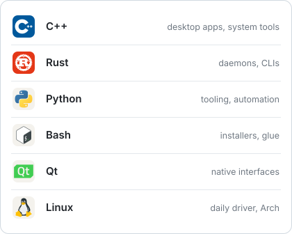

<picture><source media="(prefers-color-scheme: dark)" srcset="assets/header-dark.svg"></picture>

Hi, I'm **Trendon**. I write software for Linux, mostly around security and system tooling.
I like programs that run locally, ask for no more privileges than they need, and stay small
enough to read.

### Stack

<picture><source media="(prefers-color-scheme: dark)" srcset="assets/stack-dark.svg"></picture>

### Projects

| | |
|---|---|
| [luci-theme-pixel](https://github.com/Trendorin/luci-theme-pixel) | a monochrome pixel theme for the OpenWrt web interface |

### Contact

Questions and bug reports are welcome in the issues of each project.

Stack icons from [skill-icons](https://github.com/tandpfun/skill-icons) (MIT).
