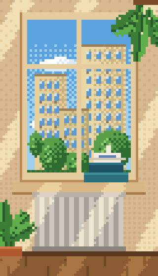
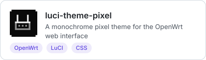
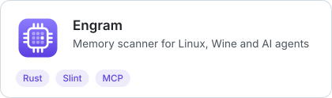
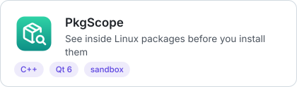
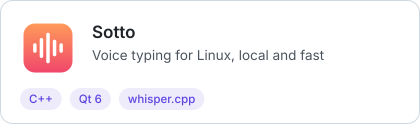

<!-- generated by build.py from profile.toml: edit the config, not this file -->

<table><tr>
<td valign="top" width="340"></td>
<td valign="top">

<h3>Hi, I'm Trendon</h3>

I write software for Linux, mostly around security and system tooling. I like programs that run locally, ask for no more privileges than they need, and stay small enough to read.

<h3>Stack</h3>
<picture><source media="(prefers-color-scheme: dark)" srcset="assets/stack-dark.svg"></picture>
<h3>Projects</h3>
<a href="https://github.com/Trendorin/luci-theme-pixel"><picture><source media="(prefers-color-scheme: dark)" srcset="assets/card-luci-theme-pixel-dark.svg"></picture></a> 
<a href="https://github.com/Trendorin/Engram"><picture><source media="(prefers-color-scheme: dark)" srcset="assets/card-engram-dark.svg"></picture></a> 
<a href="https://github.com/Trendorin/PkgScope"><picture><source media="(prefers-color-scheme: dark)" srcset="assets/card-pkgscope-dark.svg"></picture></a> 
<a href="https://github.com/Trendorin/Sotto"><picture><source media="(prefers-color-scheme: dark)" srcset="assets/card-sotto-dark.svg"></picture></a>

</td>
</tr></table>

Stack icons from <a href="https://github.com/tandpfun/skill-icons">skill-icons</a> (MIT).
