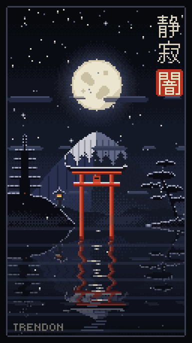
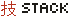
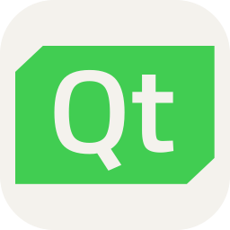
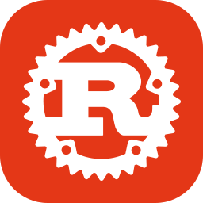
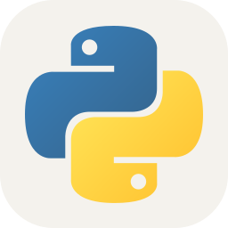
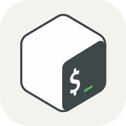
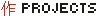
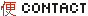

<!-- generated by build.py from profile.toml: edit the config, not this file -->

<table><tr>
<td valign="top" width="400"></td>
<td valign="top">

<picture><source media="(prefers-color-scheme: dark)" srcset="assets/gen/name-dark.svg"></picture>

I write software for Linux, mostly around security and system tooling. I like programs that run locally, ask for no more privileges than they need, and stay small enough to read.

<picture><source media="(prefers-color-scheme: dark)" srcset="assets/gen/h-stack-dark.svg"></picture>

 <picture><source media="(prefers-color-scheme: dark)" srcset="assets/icons/QT-Dark.svg"></picture> <b>C++ and Qt</b>, desktop apps and system tools 
 <b>Rust</b>, daemons and command-line tools 
<picture><source media="(prefers-color-scheme: dark)" srcset="assets/icons/Python-Dark.svg"></picture> <picture><source media="(prefers-color-scheme: dark)" srcset="assets/icons/Bash-Dark.svg"></picture> <b>Python and Bash</b>, tooling, installers, automation

<picture><source media="(prefers-color-scheme: dark)" srcset="assets/gen/h-projects-dark.svg"></picture>

<ul>
<li><a href="https://github.com/Trendorin/yami"><b>yami</b></a>, a lightweight pixel-art desktop environment for Linux, built with Rust and Niri</li>
<li><a href="https://github.com/Trendorin/luci-theme-pixel"><b>luci-theme-pixel</b></a>, a monochrome pixel theme for the OpenWrt web interface</li>
<li><a href="https://github.com/Trendorin/Engram"><b>Engram</b></a>, memory scanner for Linux, Wine and AI agents</li>
<li><a href="https://github.com/Trendorin/Sotto"><b>Sotto</b></a>, voice typing for Linux, local and fast</li>
</ul>

<picture><source media="(prefers-color-scheme: dark)" srcset="assets/gen/h-contact-dark.svg"></picture>

<a href="mailto:trendorin.marshland458@passinbox.com"><picture><source media="(prefers-color-scheme: dark)" srcset="assets/gen/btn-mail-dark.svg"></picture></a>

</td>
</tr></table>
