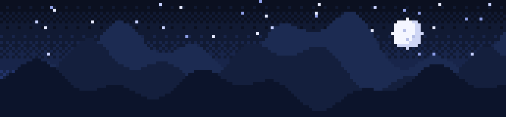

<!-- generated by build.py from profile.toml: edit the config, not this file -->

Hi, I'm **Trendon**.

I write software for Linux, mostly around security and system tooling. I like programs that run
locally, ask for no more privileges than they need, and stay small enough to read.

### Stack

<picture><source media="(prefers-color-scheme: dark)" srcset="assets/stack-dark.svg"></picture>

### Projects

<a href="https://github.com/Trendorin/luci-theme-pixel"><picture><source media="(prefers-color-scheme: dark)" srcset="assets/card-luci-theme-pixel-dark.svg"></picture></a> <a href="https://github.com/Trendorin/Engram"><picture><source media="(prefers-color-scheme: dark)" srcset="assets/card-engram-dark.svg"></picture></a>
<a href="https://github.com/Trendorin/PkgScope"><picture><source media="(prefers-color-scheme: dark)" srcset="assets/card-pkgscope-dark.svg"></picture></a> <a href="https://github.com/Trendorin/Sotto"><picture><source media="(prefers-color-scheme: dark)" srcset="assets/card-sotto-dark.svg"></picture></a>

Stack icons from <a href="https://github.com/tandpfun/skill-icons">skill-icons</a> (MIT).
